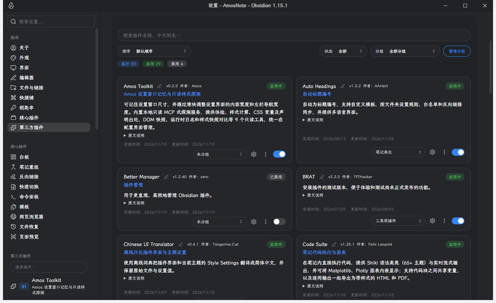
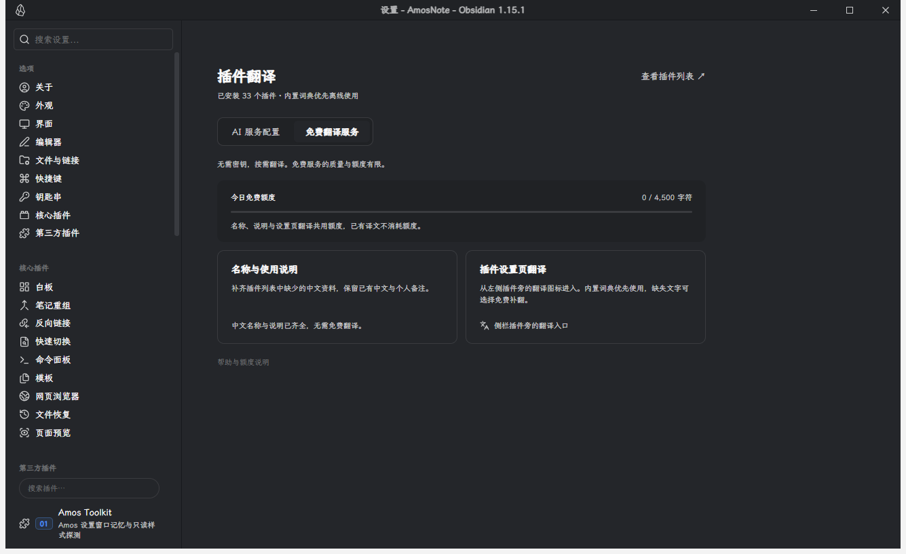

# Extension Index · 插件索引

**给已安装的 Obsidian 第三方插件补上中文别名和用途说明，顺手把排序、筛选、分组和更新查看一起做了。**

Obsidian 1.14.5+ 桌面版 · 无运行时依赖 · 无遥测 · MIT


*上图为宣传示意图，真实界面见下文截图。*

## 它解决什么问题

插件装到三十个以上，原生列表就只剩一串英文名：想找「改图标的那个」「能导出 PDF 的那个」，只能挨个点开看。

这个插件在原生「已安装插件」列表上补了三层信息：**中文别名**让你认得出，**中文说明**让你知道它干什么，**时间与更新状态**让你知道它多久没维护了。再配上搜索、状态筛选和手动分组，三十个插件也能一眼定位。

它不碰插件本身：不改代码、不改启用状态、不安装也不卸载。

## 主要功能

**中文资料**

- 内置 10,314 条离线中文别名与说明，命中即用，不需要联网。
- 个人备注优先于生成缓存，生成缓存优先于内置资料；自己写的内容永远不会被自动覆盖，也可随时恢复预置。
- 缺失条目可免费联网补全，或用你自行配置的 AI 服务依据公开资料生成；两条路径都需手动触发。

**列表管理**

- 双列卡片布局，同一行卡片等高；每张卡片显示原名、中文别名、中文说明、可折叠的原文说明，以及安装与更新时间。
- 搜索：同时匹配原名、中文别名和说明文字。
- 排序：默认顺序、原名 A→Z、原名 Z→A、更新时间最新优先 / 最早优先。
- 状态筛选带计数：全部、已启用 N、已禁用 N、待更新 N。
- 分组：手动建组、卡片内直接改归属、按组筛选；分组只影响显示，不改启用状态。
- 顶栏统计「总计 / 启用 / 禁用 / 待更新」，设置左侧导航同步显示编号与中文别名。

**更新查看**

- Obsidian 检查更新后，「待更新」筛选和卡片上的 `↑ v2.12.0` 徽标会亮起。
- 点徽标或原生「更新」按钮旁的「更新说明」，直接看该版本的 GitHub Release 说明（Markdown 渲染），不必跳浏览器。
- 按「更新时间」排序，就能看出哪些插件已经很久没动过。

**设置页翻译**

- 点设置侧栏中插件旁的翻译图标，可把该插件设置页的标题、按钮和标签页换成中文，也能随时切回原文。
- 首批内置 82 条词条，覆盖 Calendar、Dataview、Templater、Advanced Tables、Outliner，离线即可用。
- 缺失的短标签可选择补翻；只处理已识别的标题与按钮，不改写说明、输入值和下拉选项。



*已安装插件列表：顶部是搜索与排序/状态/分组，卡片内可直接改分组、进插件设置、开关插件。*

## 安装

**手动安装**（社区市场里还搜不到本插件时）

1. 从同一次 GitHub Release 下载 `main.js`、`manifest.json`、`styles.css`。
2. 放入 `<你的笔记库>/.obsidian/plugins/plugin-zh-notes/`。
3. 打开「设置 → 第三方插件」，刷新列表并启用。

升级时只替换这三个文件，**保留同目录的 `data.json`**——个人备注、分组、筛选偏好和密钥引用都在里面。

仓库默认分支和草稿 Release 不是可安装版本。正式 Release 的 tag 与 `manifest.json` 的版本号完全一致，不带 `v` 前缀。

## 使用

### 列表工具栏

打开「设置 → 第三方插件 → 已安装插件」，列表顶部会多出一条工具栏：

| 控件 | 作用 |
| --- | --- |
| 搜索框 | 按原名、中文别名、说明文字过滤 |
| 排序 | 默认顺序 / 原名 A→Z / 原名 Z→A / 更新时间最新 / 更新时间最早 |
| 状态 | 全部、已启用、已禁用、待更新（均带数量） |
| 分组 | 全部分组 / 未分组 / 自建分组 |
| 管理分组 | 新建、改名、排序、删除分组 |
| 统计行 | 总计 / 启用 / 禁用 / 待更新，不随筛选变化 |

### 卡片上的元素

| 元素 | 说明 |
| --- | --- |
| 铅笔图标 | 编辑个人别名与说明，可恢复预置内容 |
| `↑ vX` 徽标 | 有新版可更新，点击查看该版本更新说明 |
| 更新说明 | 原生「更新」按钮左侧，作用同上 |
| 分组下拉 | 把插件归入某个分组 |
| 齿轮 | 打开该插件自己的设置页 |
| 开关 | 启用 / 禁用，等同原生开关 |
| 安装时间 | 插件文件夹的创建时间 |
| 更新时间 | `manifest.json` 与 `main.js` 中较晚的修改时间 |

两个时间都是**本地文件时间**。复制、恢复或同步笔记库可能改变它们；「更新时间」反映文件被安装或覆盖的时间，不完全等于作者发布该版本的日期，但用来判断「很久没更新」足够用。

### 分组

点「管理分组」新建分组，然后在卡片底部的下拉里选择归属。分组会出现在筛选下拉和分组标题下；删除分组后，插件自动回到「未分组」。

### 补全中文资料

**免费路径**：设置 → Extension Index →「免费翻译服务」→ 免费补全名称与使用说明。

- 只补缺失项，已有中文和你的个人备注不会被覆盖。
- 名称是机器直译，品牌名、缩写可能保留原文。
- 额度：MyMemory 官方额度为每天 5,000 字符，本插件按每库每天 4,500 字符保守保护；名称、说明、设置页补翻共用同一额度。额度用尽时保留已有结果。

**AI 路径**：设置 → Extension Index →「AI 服务配置」。

1. 选择服务商与模型，填入 API Key。
2. 点「保存并测试」，只验证连接，不会自动开始批量翻译。
3. 回到「翻译名称与使用说明」点击执行。

预置 DeepSeek、通义千问（北京）、智谱 GLM、硅基流动、Kimi、OpenAI、本地 Ollama，以及任意兼容 Chat Completions 的自建地址（模型名可手填）。生成依据是插件介绍与公开 README 节选（最多 6,000 字符），**不读取你的笔记内容**。

停止按钮会阻止后续请求并丢弃迟到结果；已经发出的请求仍可能在服务商侧完成并计费。

### 设置页翻译

设置侧栏中每个第三方插件旁有一个翻译图标，点开可：

- **显示中文 / 显示原文**：按插件切换，内置译文离线生效。
- **补翻新增**：只收集当前已打开设置页里可识别的短英文标签，按批请求并逐批保存。
- 处理范围是分组标题、设置项名称、按钮和标签页；说明文字、输入内容、下拉选项和插件源码不会被改写。



*本插件设置页：两个页签分别管理 AI 服务与免费翻译，额度、进度与停止按钮集中在这里。*

## 中文资料的范围与质量

- 覆盖范围：2026-11-13 官方目录快照中下载量大于 10 次的 10,253 个插件，另保留 61 条历史条目，合计 10,314 条。
- 生成方式：一部分依据官方名称与介绍人工核校，一部分为机器翻译初稿并做术语、长度与字段校验。
- 质量边界：可能存在语义误译或内容滞后，也不代表这些插件经过安全审核或实测。
- 发现错误请提 [Issue](https://github.com/Frank998-dpf/plugin-zh-notes/issues)，附上插件 ID 与建议译法即可。数据集来源与许可见 [THIRD_PARTY_NOTICES.md](THIRD_PARTY_NOTICES.md)。

## 联网、费用与隐私

离线资料、个人备注、排序分组都不联网。只有你主动点翻译、AI 分析或更新说明时才会发请求。

| 服务 | 用途 | 发送的内容 |
| --- | --- | --- |
| `api.mymemory.translated.net` | 可选的匿名英译中 | 插件名称与公开/本地 manifest 描述，无需密钥 |
| `raw.githubusercontent.com` | 读取官方社区插件目录 | 一次公开目录请求，不上传已装插件清单 |
| `api.github.com` | 读取插件作者公开的 README 或 Release 说明 | 目标插件的公开仓库路径与版本号 |
| 你选择的 AI 接口 | 可选的说明生成、设置页补翻、连接测试 | 插件 ID、名称、版本、描述，最多 6,000 字符 README 节选；补翻时为插件 ID 与短标签；连接测试是固定短句 |

- 云服务预置连向 `api.deepseek.com`、`dashscope.aliyuncs.com`、`open.bigmodel.cn`、`api.siliconflow.cn`、`api.moonshot.cn`、`api.openai.com`；Ollama 走本机 `localhost`。远程地址必须 HTTPS，HTTP 仅允许本地。
- **不读取、不上传你的笔记正文和个人备注**，也不访问笔记库以外的文件。
- 插件本身免费；AI 服务需自备账号与密钥，可能产生费用，连接测试也会计一次调用。
- 无项目自建服务器、无遥测、无埋点、无翻译代理。
- API Key 存放在 Obsidian 的 SecretStorage，不写进 `data.json`；SecretStorage 由 Obsidian 管理，不保证跨设备同步。

## 数据与兼容性

| 文件 | 内容 |
| --- | --- |
| `data.json` | 个人别名与说明、生成缓存、分组与筛选偏好、翻译用量、AI 服务配置（不含密钥明文） |
| `release-notes.json` | 更新说明缓存，可随时删除，下次打开重新拉取 |
| SecretStorage | API Key，由 Obsidian 保管 |

- 升级保留 `data.json`；降级或删除插件目录前请先备份。
- 只支持桌面版（`isDesktopOnly`），移动端未做验证也不在声明范围内。
- 与其它重写同一设置列表的插件可能冲突；Obsidian 若改动设置面板结构，本插件需要相应适配。
- 本插件不负责安装、更新或卸载其他插件，「更新」按钮始终是 Obsidian 原生的。

## 常见问题

**为什么有的插件没有中文别名？**
品牌名或缩写（如 Templater）会保留原文；内置资料未覆盖时可以手写，或用 AI / 免费翻译补。

**为什么看不到「待更新」徽标？**
Obsidian 要先查到新版本。到「已安装插件」页点一次「检查更新」，徽标与筛选计数才会出现。

**「更新时间」和版本发布日期为什么对不上？**
它取的是本地 `manifest.json` / `main.js` 的修改时间：升级会刷新，手动覆盖也会刷新。作者发布新版本但你没更新时，这个时间不会变。

**免费额度用完了怎么办？**
换用自己配置的 AI 服务，或等次日 UTC 重置。已有译文不重复消耗额度。

**会修改我的笔记吗？**
不会。插件只读插件目录里的 `manifest.json`、`styles.css` 等文件，以及笔记库配置目录内的插件信息。

## 开发

`src/plugin.js` 是唯一源码，纯 CommonJS，无转译、无打包、无运行时依赖；`main.js` 由构建脚本原样复制生成。

```bash
npm ci
npm run build   # 校验 src/plugin.js 并同步到 main.js
npm test        # Node 内置测试运行器
```

- 测试覆盖排序/筛选/分组、数据迁移、翻译与 AI 响应解析、Release 说明解析、构建产物一致性等，当前 91 项全部通过。
- 修改 `src/plugin.js` 后必须重新 `npm run build`，否则「构建一致」测试会失败。
- 发版靠打 tag：`manifest.json` 改好版本、`CHANGELOG.md` 补好该版本段落，推一个同名 tag（如 `0.7.0`，不带 `v`）即可。工作流会重新构建、跑测试、确认提交的产物未被改动，再用该版本的 CHANGELOG 段落作为 Release 说明，上传 `main.js`、`manifest.json`、`styles.css`。
- 桌面验收在独立 QA 库完成，自动化测试不能替代真实界面检查。

## 许可与署名

插件实现与本地整理：**Copyright (c) 2026 Frank998-dpf**，[MIT](LICENSE)。

内置中文资料派生自 [miaoziguan/obsidian-chinese-plugin-market](https://github.com/miaoziguan/obsidian-chinese-plugin-market)（固定提交 `c14006e`，MIT，**Copyright (c) 2024 羽鳞君 (miaoziguan)**），并依据官方社区目录做了字段筛选、清理与部分改写；未复制任何上游插件运行时代码。完整声明见 [THIRD_PARTY_NOTICES.md](THIRD_PARTY_NOTICES.md)，上游 MIT 许可全文同时内嵌在 `main.js` 中。

## 反馈

Bug 与译文纠错请提到 [GitHub Issues](https://github.com/Frank998-dpf/plugin-zh-notes/issues)，尽量附上目标插件 ID 与复现步骤。截图或日志请先移除 API Key、个人路径和笔记内容。
